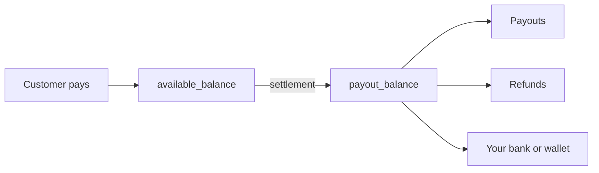

Each account has two balances:

| Balance | What it holds | Can you spend it? |
| --- | --- | --- |
| `available_balance` | Money from customer payments that is **waiting to settle**. | Not yet. |
| `payout_balance` | Settled money: your Modem Pay wallet. | Yes. Payouts, refunds and withdrawals come from here. |



## Check your balance

<CodeGroup>
```javascript nodejs
const balance = await modempay.balances.retrieve();
// { payout_balance: 10, available_balance: 0 }
```
```python python
balance = modem_pay.balances.retrieve()
# {'payout_balance': 10, 'available_balance': 0}
```
```bash cURL
curl https://api.modempay.com/v1/balances \
  -H "Authorization: Bearer sk_test_..."
```
</CodeGroup>

A restricted key needs the `balance:read` permission.

## Things that change your payout balance

| Goes down | Goes up |
| --- | --- |
| A payout, plus its fee | Settlement of your available balance |
| A refund to a customer | A failed or cancelled payout (refunded in full) |
| | A reversed payout, including its fee |

<Tip>
  Before a big [bulk payout](/documentation/payouts/bulk-payout), check `payout_balance` covers the total **plus fees**. If it doesn't, the whole batch is refused.
</Tip>

Each account, and each mode (test or live), has its own balances.
