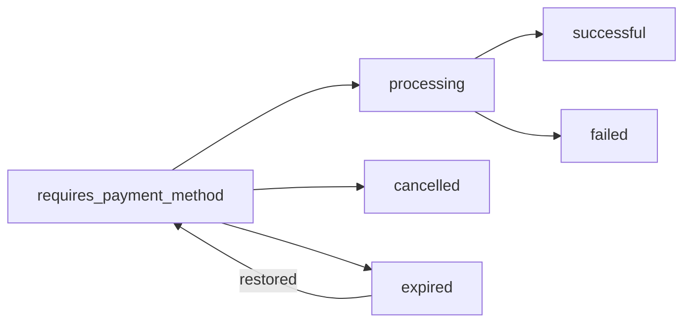

A **payment intent** says "this customer should pay this amount". You create it on your server, Modem Pay gives you a `payment_link`, and the customer pays there. Every integration, from the pay button to payment links, creates one behind the scenes.



## What you can send

Only `amount` is required.

| Field | What it does |
| --- | --- |
| `amount` | How much to charge, in GMD. At least 10. |
| `currency` | Defaults to your account's currency. |
| `title`, `description` | Shown to the customer at checkout. |
| `customer` | A [customer](/documentation/core/customers) ID. Their saved payment methods are offered. |
| `customer_name`, `customer_email`, `customer_phone` | Fill in checkout for a customer you haven't saved. |
| `payment_methods` | Limit the choice, like `["wallet"]` or `["card"]`. |
| `payment_method` | Charge one specific saved payment method. |
| `network`, `account_number` | [Direct charge](/documentation/payment-intents/direct-charge) a mobile wallet. |
| `coupon` | A [coupon](/documentation/core/coupons) ID or name. Its discount is taken off. |
| `sub_account`, `sub_account_group` | [Split the payment](/documentation/split-payments/initialize-payment) with partners. |
| `metadata` | Your own data, like an order ID. Comes back on the transaction and every webhook. |
| `return_url` | Where the customer goes after paying. |
| `cancel_url` | Where the customer goes if they cancel. |
| `callback_url` | Send this payment's events here instead of your webhook. See [Callback URL](/documentation/payment-intents/callback_url). |
| `skip_url_validation` | Set `true` when `return_url` or `cancel_url` is a mobile app deep link, like `myapp://paid`. |

## What you get back

```json
{
  "status": true,
  "message": "Payment intent created successfully. Please proceed to complete the payment.",
  "data": {
    "intent_secret": "bfa7eb3ea516ee15f80915a922c00242…",
    "payment_link": "https://test.checkout.modempay.com/…",
    "amount": 450,
    "currency": "GMD",
    "status": "requires_payment_method",
    "expires_at": "2025-03-01T12:30:00.000Z"
  }
}
```

| Field | What it is |
| --- | --- |
| `payment_link` | Send the customer here to pay. |
| `intent_secret` | Use it to [look the intent up](/documentation/payment-intents/management#check-a-payment) later. Keep it on your server. |
| `expires_at` | After this, the link stops working and you get `payment_intent.expired`. |
| `status` | Where the payment stands. See below. |

## Statuses

| Status | Meaning |
| --- | --- |
| `requires_payment_method` | Waiting for the customer to pay. |
| `processing` | The customer is paying right now. |
| `successful` | Paid. |
| `failed` | The payment didn't go through. |
| `cancelled` | You or the customer cancelled it. |
| `expired` | It wasn't paid in time. |

## Next

<CardGroup cols={2}>
  <Card title="Create a payment intent" icon="plus" href="/documentation/payment-intents/create">
    Examples from simple to saved customers.
  </Card>
  <Card title="Check, list and cancel" icon="magnifying-glass" href="/documentation/payment-intents/management">
    Confirm a payment and clean up old ones.
  </Card>
</CardGroup>
