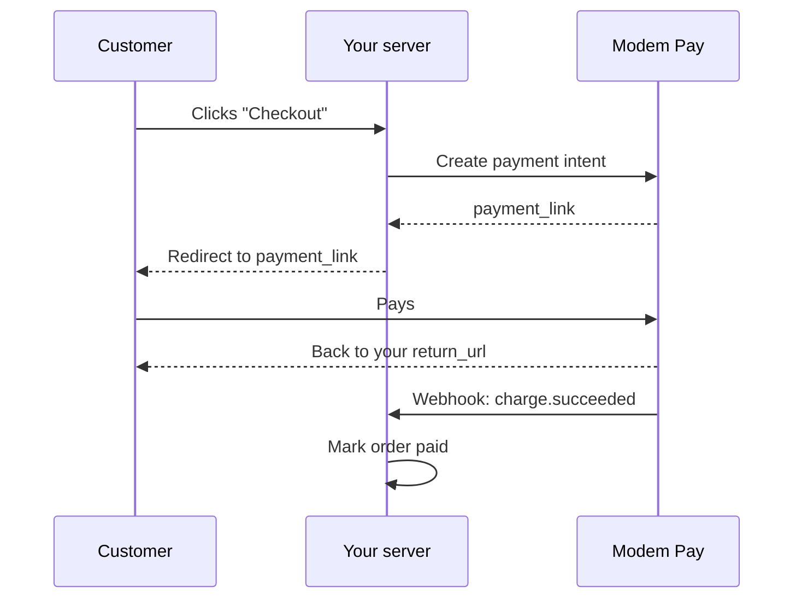

This is the most flexible way to accept payments. Your server creates a **payment intent** for each order, so the price can't be changed in the browser, and you can add split payments, coupons, saved customers and your own references.



## Complete example

A small Express app: a checkout button, a page to come back to, and a webhook endpoint.

<CodeGroup>
```javascript server.js
import express from "express";
import ModemPay from "modem-pay";

const modempay = new ModemPay(process.env.MODEMPAY_SECRET_KEY);
const app = express();
const DOMAIN = "http://localhost:7024";

// 1. Create the payment on the server, with the price from your database.
app.post("/checkout", express.urlencoded({ extended: false }), async (req, res) => {
  const order = { id: "1042", amount: 2000, title: "Stubborn Attachments" };

  const intent = await modempay.paymentIntents.create({
    amount: order.amount,
    title: order.title,
    metadata: { order_id: order.id },
    return_url: `${DOMAIN}/success.html`,
    cancel_url: `${DOMAIN}/cancel.html`,
  });

  // 2. Send the customer to pay.
  res.redirect(303, intent.data.payment_link);
});

// 3. Mark the order paid when Modem Pay tells you. Use the raw body to check the signature.
app.post("/webhook", express.raw({ type: "application/json" }), (req, res) => {
  let event;
  try {
    event = modempay.webhooks.composeEventDetails(
      req.body.toString("utf8"),
      req.headers["x-modem-signature"],
      process.env.MODEMPAY_WEBHOOK_SECRET,
    );
  } catch {
    return res.status(400).send("Invalid signature");
  }

  res.sendStatus(200);

  if (event.event === "charge.succeeded") {
    const orderId = event.payload.metadata?.order_id;
    // markOrderPaid(orderId, event.payload.amount)
  }
});

app.use(express.static("public"));
app.listen(7024, () => console.log("Running on http://localhost:7024"));
```

```html public/index.html
<!DOCTYPE html>
<html>
  <body>
    <h3>Stubborn Attachments</h3>
    <p>GMD 2,000.00</p>
    <form action="/checkout" method="POST">
      <button type="submit">Checkout</button>
    </form>
  </body>
</html>
```

```html public/success.html
<!DOCTYPE html>
<html>
  <body>
    <p>Thanks! We're confirming your payment and will email you shortly.</p>
  </body>
</html>
```

```html public/cancel.html
<!DOCTYPE html>
<html>
  <body>
    <p>Payment cancelled. Your cart is still waiting for you.</p>
  </body>
</html>
```
</CodeGroup>

Run it with your test key and webhook secret, then use the [CLI](/documentation/cli) to get webhooks on your machine:

```bash
modempay listen --forward-url http://localhost:7024/webhook
```

## Why the price comes from the server

The browser only sends "I want to check out". Your server decides the amount. Nobody can change the price by editing your page.

## Going further

<CardGroup cols={2}>
  <Card title="All payment intent options" icon="sliders" href="/documentation/payment-intents/overview">
    Customers, coupons, payment methods, callbacks and more.
  </Card>
  <Card title="Charge a wallet directly" icon="mobile-screen" href="/documentation/payment-intents/direct-charge">
    Skip the checkout page and send the request to the customer's phone.
  </Card>
  <Card title="Split the payment" icon="arrows-split-up-and-left" href="/documentation/split-payments/initialize-payment">
    Send part of each payment to a partner.
  </Card>
  <Card title="Refund" icon="rotate-left" href="/documentation/payment-intents/refund">
    Give money back, in full or in part.
  </Card>
</CardGroup>
